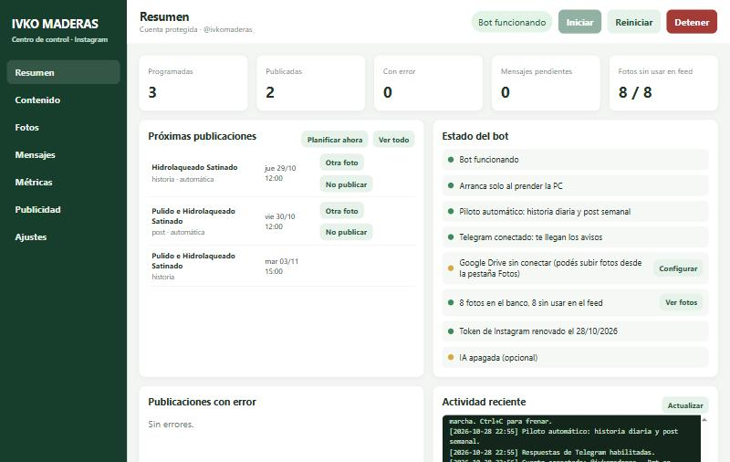
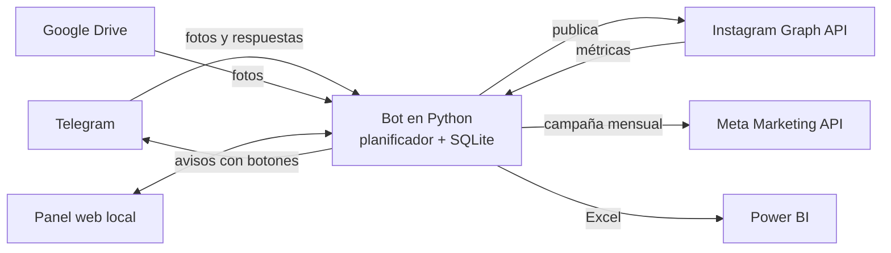

# Bot de Instagram autónomo para un negocio de servicios

Automatización completa de la cuenta de Instagram de **Ivko Maderas** (pulido y plastificado de pisos de madera):
publica sola, avisa por Telegram, mide resultados, administra la publicidad paga con un presupuesto mensual y exporta
las métricas a Excel para armar dashboards en Power BI. Usa solo las **APIs oficiales de Meta**.



## Qué hace

| | |
|---|---|
| 📅 **Piloto automático** | Una historia por día y un post por semana, en los horarios de mayor interacción calculados con las métricas propias. |
| 📷 **Banco de fotos** | Las fotos llegan por Telegram, Google Drive o el panel. Con `(historia)` o `(publicacion)` en el texto se elige el destino; los posts nunca repiten foto y las historias rotan. |
| 🎨 **Diseño automático** | Recorta a 4:5 para el feed y arma la historia 9:16 con texto, botón y colores de la marca (Pillow). |
| 🔔 **Aprobación con plazo** | Antes de publicar manda la imagen por Telegram con botones *Otra foto* / *No publicar*. Si no se toca nada, sale sola. |
| 💬 **Mensajes** | Los DMs de Instagram llegan a Telegram y se responden desde ahí. IA opcional (Claude) para clasificar y sugerir respuestas. |
| 📣 **Publicidad paga** | Campaña mensual con presupuesto total fijo (Meta Marketing API): no se excede, se renueva sola cada mes, con zonas elegidas (ciudades, barrios, radio en km). |
| 📊 **Métricas → Power BI** | Sincroniza alcance, guardados, compartidos y seguidores; genera un Excel con tablas listas para Power BI. |
| 🖥️ **Panel web local** | Controla todo: estado, contenido, banco de fotos, mensajes, métricas, publicidad y ajustes. |
| 🛡️ **Robusto** | Reintentos ante cortes de red, renovación automática del token, nunca publica dos veces, arranque con Windows. |

**Tecnologías:** Python 3.13 · Instagram Graph API · Meta Marketing API · Telegram Bot API · Google Drive API ·
SQLite · Pillow · openpyxl · Anthropic API (opcional) · Cloudinary · HTML/JS sin frameworks.



## Métricas en Power BI

El bot genera todos los días `salida/metricas_instagram.xlsx` (también se descarga desde **Panel → Métricas**).
Cada hoja es una tabla con nombre (`tbl_Publicaciones`, `tbl_Seguidores_diarios`, `tbl_Horarios`, `tbl_Publicidad`,
`tbl_Programacion_bot`, `tbl_Banco_fotos`, `tbl_Mensajes`). En Power BI: **Obtener datos → Excel → elegir las tablas**,
y después **Actualizar** para traer los datos nuevos. También: `python main.py excel`.

---

# Guía de instalación

## Panel visual

Abrí **Abrir_Panel.bat** para iniciar el panel local en el navegador. También podés abrir
http://127.0.0.1:8765/ mientras el panel esté encendido. Escucha solo en esta computadora.

- **Arriba**: iniciar, reiniciar o detener el bot (también si arrancó solo con Windows).
- **Resumen**: estado de cada función con su botón para configurarla, próximas publicaciones con **Otra foto** / **No publicar**,
  publicaciones con error (con **Reintentar**), botón **Planificar ahora** y la actividad reciente del bot.
- **Contenido**: todas las publicaciones con filtros. Podés editar el pie de foto, el texto de la historia y la hora incluso
  de las ya programadas, cambiar la foto, cancelar o reintentar. "Crear borradores con fotos" mantiene el flujo manual.
- **Fotos**: el banco del piloto automático. Subí fotos (también HEIC), corregí el pie de foto de cada una, pausalas o
  permití que vuelvan a salir en el feed.
- **Mensajes**: respondé manualmente desde el panel. La IA y las respuestas automáticas empiezan apagadas.
- **Métricas**: sincronizá seguidores, alcance, likes y comentarios; el panel compara el rendimiento según día y hora.
- **Ajustes**: inicio automático con Windows, renovar el token, piloto automático (hora de la historia, anticipación del
  aviso), Telegram con prueba de envío, Google Drive (subir el JSON y pegar el link de la carpeta), diseño de las historias
  (texto, botón, marca, color), WhatsApp e IA. Las claves se guardan en el archivo .env local y nunca se vuelven a mostrar.
  Al guardar, si el bot está corriendo se reinicia solo para aplicar los cambios.

Los horarios recomendados salen de la interacción de tus publicaciones (likes y comentarios) y muestran cuántos datos los respaldan. Si Meta entrega el indicador de seguidores conectados, el panel también lo muestra; si no lo habilita para la cuenta, informa que la recomendación es una aproximación basada en publicaciones anteriores.

### Vincular Telegram para recibir y responder mensajes

1. En Telegram, hablá con **@BotFather** y creá tu propio bot.
2. Pegá el token de ese bot en **Ajustes → Telegram** y guardá.
3. Abrí el chat privado con tu bot, enviá /start y volvé al panel.
4. Tocá **Detectar chat**, elegí tu chat privado y guardá los ajustes.
5. Cuando llegue un DM, respondé a su aviso en Telegram. El bot reenvía esa respuesta por Instagram y confirma el resultado.

El número de teléfono no es el Chat ID ni el token de Telegram, por eso no se guarda como credencial. El token de BotFather es imprescindible para activar esta conexión. El bot acepta respuestas solo desde el chat privado configurado. Telegram entrega actualizaciones con getUpdates; si ese bot ya tiene un webhook configurado, habrá que desactivarlo para habilitar la escucha local.

La IA necesita una clave de Anthropic. Al habilitarla, el panel avisa que el texto de los mensajes se enviará a Anthropic para crear sugerencias. Las respuestas automáticas tienen una confirmación adicional y permanecen apagadas hasta que las actives.

## 1. Requisitos

- Python 3.10 o superior.
- Cuenta profesional de Instagram **Business o Creator**. Este bot usa **Instagram Login**, que no requiere vincular una Página de Facebook.
- Esta copia está limitada a **@ivkomaderas_**; rechaza credenciales de cualquier otra cuenta.
- Una cuenta de desarrollador en https://developers.facebook.com
- Una clave de API de Anthropic: https://console.anthropic.com

## 2. Instalar

```bash
cd C:\Users\Usuario\Documents\Codex\instagram_bot
python -m venv venv
venv\Scripts\Activate.ps1
python -m pip install -r requirements.txt
Copy-Item .env.example .env
```

Los archivos de configuración, la base de datos y las carpetas `fotos/` y `salida/` se ubican junto a `main.py`, aunque ejecutes el comando desde otra carpeta.

## 3. Conectar @ivkomaderas_

La app `bot pisos` ya tiene el caso de uso **API de Instagram**. En Meta Developers → Casos de uso → personalizar **API de Instagram** → **Configuración de la API con inicio de sesión con Instagram**:

1. Habilitá los permisos `instagram_business_basic` y `instagram_business_content_publish`. Si vas a usar la bandeja de mensajes del bot, habilitá también `instagram_business_manage_messages`.
2. En **Roles de la app**, agregá `@ivkomaderas_` como evaluador de Instagram. Meta debe aceptar ese rol antes de generar el token. Si aparece el aviso de que hace falta una cuenta de desarrollador de Facebook, registrá como desarrollador el perfil de Facebook asociado a `@ivkomaderas_` y volvé a intentarlo.
3. Volvé a configuración de Instagram Login, elegí **Agregar cuenta** y autorizá solamente `@ivkomaderas_`. Copiá el token que Meta genere para esa cuenta.
4. Abrí una consola en esta carpeta y ejecutá `venv\Scripts\python.exe obtener_token.py`. El asistente solicita el identificador y la clave secreta de la app de Instagram, más el token recién generado; las entradas sensibles no se muestran. Intercambia el token por uno de larga duración y lo guarda en `.env` solo si la API confirma que pertenece a `@ivkomaderas_`.
5. Ejecutá `venv\Scripts\python.exe main.py init` para comprobar la conexión.

No agregues ni autorices otras cuentas. Para publicaciones programadas, completá también las credenciales de Cloudinary de la sección siguiente. Los tokens largos de Instagram vencen y deben renovarse periódicamente; este asistente no los imprime.

> Mientras tu app esté en **modo desarrollo** funciona con tu propia cuenta. Para uso continuo en producción Meta puede pedir
> **revisión de la app** para algunos permisos (sobre todo mensajes).

Completá también `DESCRIPCION_NEGOCIO` (cuanto más detallado, mejores textos) y `WHATSAPP_NUMERO` (solo dígitos, con código de país, ej. `5491112345678`).

**Avisos por Telegram:** vinculá el token y el chat privado desde Ajustes del panel. Las claves quedan en el .env local.

## 4. Publicaciones e historias a partir de tus fotos

El bot trabaja sobre **tus fotos de trabajos terminados**:

1. Dejá las fotos en la carpeta `fotos/`.
2. Escribí en el nombre del archivo el pie de foto que querés publicar. El bot usa ese nombre exactamente, sin la extensión `.jpg` (o la que tenga).
3. *(Opcional)* Al lado de cada foto, un `.txt` con el mismo nombre y los **datos reales** del trabajo:
   `living-caballito.jpg` + `living-caballito.txt` → `Living en Caballito, 38 m2, pulido y plastificado mate`.
   La nota puede ayudar a Claude con el contenido de la historia, pero no cambia el pie de foto del post. Claude no inventa metros, zonas, precios ni plazos.
4. *(Opcional)* Para un **antes/después**, nombrá `nombre_antes.jpg` y `nombre_despues.jpg`: arma una sola imagen comparativa y usa `nombre` como pie de foto.
4. Corré `python main.py fotos` (o dejá el bot en marcha, que revisa la carpeta solo).

Por cada trabajo crea **dos borradores**:

- **Post** de feed: foto recortada a 4:5 + pie de foto igual al nombre del archivo, sin la extensión. No agrega texto, hashtags ni llamada a la acción.
- **Historia**: foto en 9:16 con una frase corta y un botón "Pedí tu presupuesto por DM" encima (usa `NOMBRE_MARCA` y `COLOR_MARCA`).

Las imágenes terminadas quedan en `salida/` para que las mires antes de aprobar. Los originales se mueven a `fotos/usadas/`.

Instagram solo acepta imágenes desde una **URL pública**: el bot las sube solo a **Cloudinary** (cuenta gratis en cloudinary.com;
copiá *Cloud name*, *API key* y *API secret* al `.env`).

```bash
python main.py init          # prueba la conexión
python main.py fotos         # crea borradores desde fotos/
python main.py borradores    # los ves (y el archivo de imagen de cada uno)
python main.py editar 1 --texto "Descripción a publicar con tus hashtags" --hora 2026-11-02T19:00:00-03:00
python main.py aprobar 1     # aprueba: se publica sola en el horario pico asignado
python main.py aprobar 2 --hora 2026-11-02T19:00:00-03:00   # o elegís vos la hora
python main.py rechazar 3
python main.py reporte       # métricas + recomendaciones
```

Editá o rechazá cualquier borrador antes de aprobarlo. El bot solo publica contenido que aprobaste; para las historias, revisá la imagen en `salida/` y configurá `TEXTO_HISTORIA` y `CTA_HISTORIA` en `.env` antes de generarla.

`python main.py generar` sigue existiendo para borradores solo de texto, pero ahí tenés que pasar una imagen con `--imagen URL`.

**Limitaciones de las historias:** la API oficial no permite agregar stickers de enlace ni de encuesta; por eso el botón de la
historia es solo visual y lleva a escribir por DM. Los videos y reels quedan para una próxima versión.

## 5. Piloto automático: historia diaria y post semanal

Con `AUTOPILOTO=si` (viene activado) el bot trabaja solo:

- **Una historia por día**, en el horario pico de ese día (o `HORA_HISTORIA` mientras no haya métricas).
- **Un post por semana**, en el día y la hora con mejor interacción (sin datos suficientes: jueves 19 h).
- Elige la foto con anticipación (la historia el día anterior y el post `DIAS_AVISO_POST` días antes) y
  **te la manda por Telegram** con dos botones: **🔄 Otra foto** y **⏭ No publicar**. Si no tocás nada, se publica sola.
- Los posts usan fotos que nunca salieron en el feed. Las historias pueden repetir fotos, empezando por la que hace más
  tiempo que no se usa. Cuando quedan pocas fotos sin usar, te avisa.
- El pie de foto del post es el nombre del archivo, como siempre. Si el nombre es el de la cámara (`IMG_2034`,
  `WhatsApp Image…`), usa `CIERRE_POST` + `HASHTAGS` (o la IA, si está activada). Conviene renombrar las fotos antes de subirlas.
- `TEXTO_HISTORIA` y `CTA_HISTORIA` aceptan varias frases separadas por `|` y se van turnando día a día.
- En Telegram, `/estado` muestra lo próximo que se va a publicar. Desde el panel también podés rechazar una publicación programada.

### De dónde saca las fotos

1. **Telegram** (lo más rápido desde el celular): mandale la foto a tu bot de avisos. El texto que escribas junto a la
   foto es el pie de foto del post. Si la mandás sin texto, el bot te pide que respondas a su mensaje con el pie de foto.
   Podés mandar varias juntas. Para no perder calidad, mandala como "archivo" en vez de como foto.
2. **Google Drive**: una carpeta que el bot revisa sola. Ver la guía de abajo.
3. La pestaña **Fotos** del panel, o la carpeta local `fotos/automatico/`.

Las fotos entran al **banco** (`fotos/banco/`). Las fotos HEIC del iPhone se convierten solas a JPG.
La carpeta `fotos/` (sin subcarpeta) y la carga desde el panel siguen funcionando como antes: crean borradores para aprobar a mano.

### Conectar Google Drive (una sola vez)

1. Entrá a https://console.cloud.google.com y creá un proyecto (por ejemplo "bot-instagram").
2. En **APIs y servicios → Biblioteca**, buscá **Google Drive API** y tocá **Habilitar**.
3. En **APIs y servicios → Credenciales → Crear credenciales → Cuenta de servicio**, ponele un nombre y terminá.
4. Entrá a la cuenta de servicio → pestaña **Claves → Agregar clave → JSON**. Se descarga un archivo:
   renombralo a `credenciales_google.json` y ponelo en esta carpeta (junto a `main.py`). No lo compartas.
5. En Google Drive creá una carpeta (por ejemplo "Fotos Instagram") y **compartila como Editor** con el mail de la cuenta
   de servicio (termina en `iam.gserviceaccount.com`; figura en el JSON como `client_email`).
6. Abrí la carpeta en el navegador: la URL termina en `/folders/XXXXXXXX`. Copiá ese código en el `.env`:
   `DRIVE_CARPETA_ID=XXXXXXXX`
7. Probá: `venv\Scripts\python.exe main.py drive`

Desde ese momento subí fotos a esa carpeta. El bot las descarga y las mueve a la subcarpeta `usadas` de Drive para saber
que ya las tomó (no se borra nada).

```bash
python main.py drive                   # prueba la conexión con Drive y lista fotos nuevas
python main.py plan                    # trae fotos y programa ya la historia y el post
python main.py estado                  # próximas publicaciones y fotos en el banco
python main.py importar fotos\usadas   # carga al banco fotos que ya tenías
```

## 6. Dejarlo funcionando

Ejecutá **Activar_Inicio_Automatico.bat** una vez: crea un acceso en la carpeta Inicio de Windows para que el bot arranque
solo, en segundo plano, cada vez que inicies sesión. El registro queda en `salida/bot.log`. Para sacarlo,
**Desactivar_Inicio_Automatico.bat**. Nunca corren dos bots a la vez: si el panel intenta arrancar otro, no se inicia.

El bot:

- Si arranca sin internet, espera y reintenta en vez de cerrarse.
- Si una tarea falla (métricas, mensajes, Drive), las demás siguen funcionando. Los errores te llegan por Telegram una sola vez.
- Reintenta hasta 3 veces una publicación que falló, y nunca repite una publicación que se cortó a mitad de camino.
- **Renueva solo el token de Instagram** cada 7 días (dura 60), así no se vence mientras el bot esté corriendo.
- Si la PC estuvo apagada todo el día, no publica la historia atrasada: sigue con la del día.

Para que corra 24/7 la PC tiene que estar prendida y **sin suspenderse** (Configuración → Sistema → Inicio/apagado y
suspensión → Suspender: Nunca, al menos con el cargador conectado). La alternativa es un VPS o una Raspberry Pi.

Mensajes importantes pendientes:

```bash
python main.py bandeja
python main.py responder <ID_DEL_MENSAJE> "Tu respuesta personalizada"
```

## Publicidad paga (Panel → Publicidad)

- **Presupuesto mensual fijo**: cada mes el bot crea en Meta una campaña con ese monto como presupuesto total y fecha de
  fin el último día. Meta lo reparte día a día y no puede gastar más. Si la activás a mitad de mes usa la parte
  proporcional a los días que quedan. El día 1 renueva la campaña sola, así nunca se corta.
- **Zonas**: buscá ciudades, barrios, provincias o códigos postales de Argentina; a las ciudades se les puede sumar un
  radio de 17 a 80 km. Los cambios se aplican enseguida.
- **Publicaciones**: elegís cuáles promocionar; el presupuesto se reparte entre todas. Objetivo: mensajes por DM (o alcance).
- Si cambiás el presupuesto a mitad de mes, respeta lo ya gastado y ajusta lo que queda.
- Todo se crea en pausa y se activa solo si todos los pasos salieron bien; si Meta rechaza algo, se borra y te muestra el error.
- Requisitos: cuenta publicitaria con medio de pago, Página de Facebook vinculada a @ivkomaderas_ y un token de
  "usuario del sistema" (los pasos están en el panel).

## 7. Límites y cuidados (importante)

- **Ventana de 24 horas**: Instagram solo deja responder un DM dentro de las 24 h posteriores al último mensaje de la persona.
- **Modo sin IA** (`MODO_SIN_IA=si` en el `.env`): no hace falta clave de Anthropic ni se paga nada por uso.
  - **Mensajes:** en modo manual, el bot deriva cada DM al panel y, si Telegram está conectado, también al chat privado del bot para que contestes desde allí.
  - **Fotos:** el post lleva tu nota del `.txt` (o "Trabajo terminado.") + `CIERRE_POST` + `HASHTAGS`. La historia usa `TEXTO_HISTORIA` y `CTA_HISTORIA`. Todo se configura en el `.env`. El bot no mira la foto, así que conviene escribir una nota en cada `.txt`.
  - **Reporte:** muestra las métricas y los horarios pico, sin recomendaciones.
  - Para pasar a IA más adelante: poné `MODO_SIN_IA=no`, cargá `ANTHROPIC_API_KEY` y listo, sin tocar nada más.
- **Pausá las respuestas automáticas** (con IA activa) poniendo `RESPUESTAS_AUTOMATICAS=no`: ojo, el bot igual clasifica con IA y consume API. Para no usar IA en absoluto, usá `MODO_SIN_IA=si`.
- **Revisá la clasificación** los primeros días: ningún clasificador es perfecto. Ante la duda, el bot te deriva a vos.
- Las respuestas automáticas tienen que dejar claro que podés estar hablando con un asistente si te lo preguntan; ajustá el prompt de `bandeja.py` según tus reglas.
- **Cumplimiento**: usá solo esta API oficial. Herramientas que simulan ser un usuario violan los términos de Instagram y arriesgan el bloqueo.
- No compartas el `.env` ni subas tus claves a ningún repositorio.

## 8. Estructura

| Archivo | Para qué sirve |
|---|---|
| `main.py` | Comandos y bucle principal |
| `ig_api.py` | Conexión con Instagram Login y validación de @ivkomaderas_ |
| `metricas.py` | Sincronización, horarios pico, reporte |
| `contenido.py` | Borradores, aprobación, publicación |
| `fotos.py` | Fotos → post 4:5, historia 9:16, antes/después, textos con Claude |
| `planificador.py` | Piloto automático: banco de fotos, historia diaria, post semanal |
| `drive.py` | Lectura de fotos desde Google Drive |
| `publicidad.py` | Publicidad paga: campaña mensual con presupuesto fijo, zonas y publicaciones elegidas |
| `exportar.py` | Excel de métricas para Power BI |
| `hosting.py` | Sube las imágenes a Cloudinary para obtener la URL pública |
| `bandeja.py` | Clasificación y respuesta de mensajes |
| `telegram_bridge.py` | Reenvío de mensajes y respuestas desde Telegram |
| `panel_server.py` / `panel_ui.py` | Interfaz, métricas, edición y ajustes del panel |
| `ia.py` | Llamadas a Claude |
| `db.py` / `config.py` | Base de datos local y configuración |
